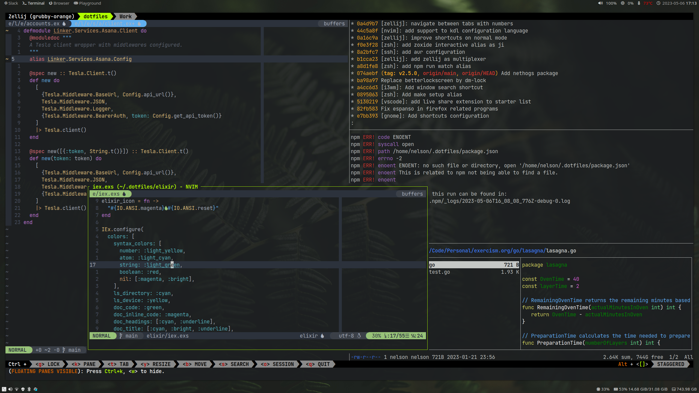
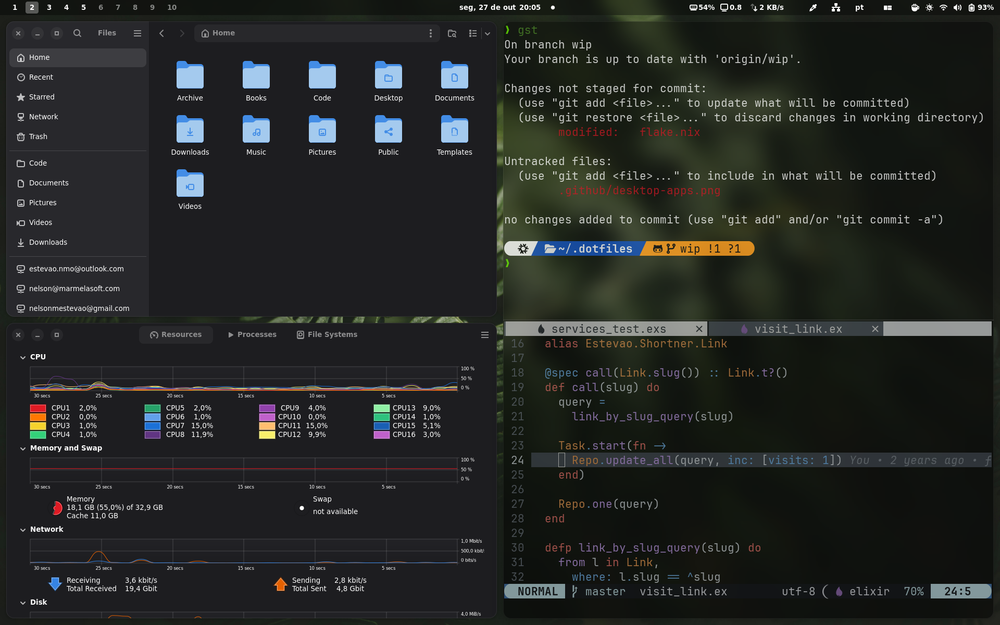
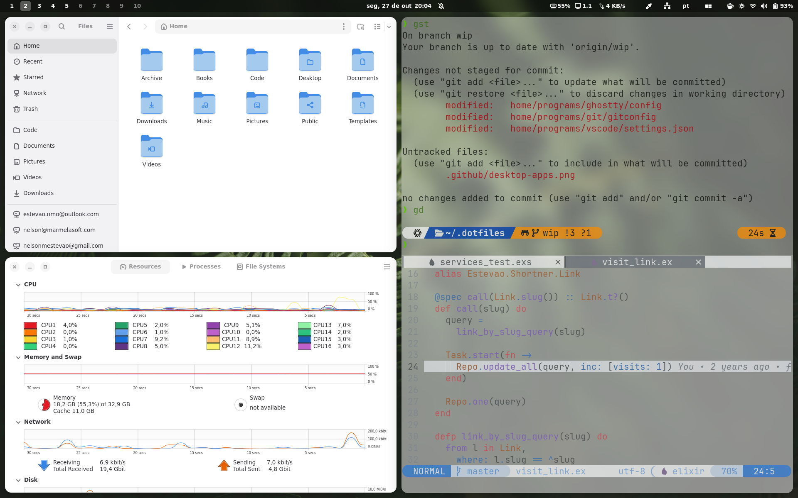
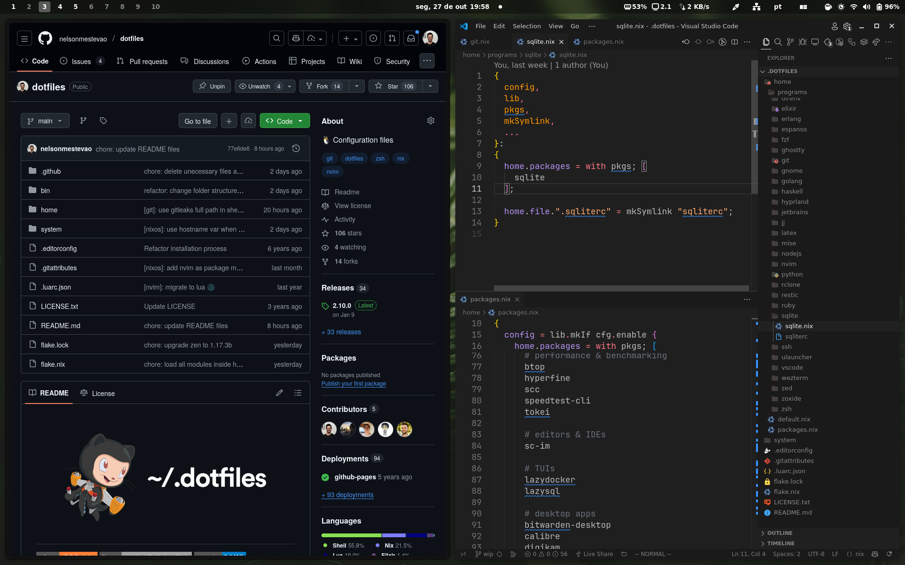

[releases]: https://github.com/nelsonmestevao/dotfiles/releases/latest
[ci]: https://github.com/nelsonmestevao/dotfiles/actions/workflows/ci.yml
[license]: #-license
[spells]: https://github.com/nelsonmestevao/spells

<h1 align="center">
<picture>
  <source media="(prefers-color-scheme: dark)" srcset="/.github/header-LIGHT.png">
  <source media="(prefers-color-scheme: light)" srcset="/.github/header-DARK.png">
  
</picture>
</h1>

[][releases]
[][ci]
[][license]


I enjoy customizing every aspect of my system. This repository contains my
complete setup — from configuration files for the tools I use (managed through
symlinks) to the declarative configuration of my entire system using the Nix
package manager, language, and operating system.

If you're just getting started, feel free to use my setup (_I don't mind_ — see
the [LICENSE][license]). But for your own good, **take the time to read through
it**. You won't get the most out of it otherwise.

<div align="center">
  
</div>

<div align="center" class="flex">
  <sub>Light and Dark mode support.</sub><br/>
  
  
</div>

<div align="center">
  <sub>Desktop apps like VS Code and Zen Browser.</sub><br/>
  
</div>

## 🧩 Overview

This configuration is as modular as I can make it. It's split into two main
layers:

- **`home/`** — portable Home Manager configuration that works across any Linux
distribution **and macOS**. Most modules run everywhere; platform-specific ones
like GNOME, Hyprland, or Vicinae are simply left disabled where they don't
apply, and cross-platform modules (e.g. Ghostty, Docker) adapt their config per
OS via `pkgs.stdenv.isDarwin`.

- **`system/`** — OS-level configuration for both **NixOS** (Linux) and
**nix-darwin** (macOS). It holds only what's truly necessary for the system
layer (at least I try to), with modules split by platform under
`system/modules/nixos/` and `system/modules/darwin/`.

Together these produce three kinds of builds: NixOS hosts, nix-darwin (macOS)
hosts, and standalone Home Manager setups on any other machine. These are my
hosts today:

| Host                    | Build             | Roles     | System           | What runs there                           |
| ----------------------- | ----------------- | --------- | ---------------- | ----------------------------------------- |
| `framework`             | NixOS             | `desktop` | `x86_64-linux`   | GNOME desktop with my full set of apps    |
| `temis`                 | NixOS             | `server`  | `x86_64-linux`   | No desktop: SSH, Tailscale, and Docker    |
| `thinkpad`              | Home Manager only | —         | `x86_64-linux`   | Another Linux distro; only my home config |
| `Remote-Nelson-Estevao` | nix-darwin        | `desktop` | `aarch64-darwin` | A Mac managed by [Workbrew] (MDM)         |

### How modules work

Each program lives in its own folder under `home/programs/` as a self-contained
module. A helper called `mkHomeModule` wraps each one, providing a
`dotfiles.programs.<name>.enable` option and a `mkSymlink` function for
linking config files back to this repo.

> [!NOTE]
> `mkSymlink` creates **true symlinks** (on Linux and macOS alike) pointing
> directly from your home directory into this repo, so you can edit config files
> in place and see changes immediately — no rebuild needed. This is how I like
> it. A path that is not in the repo fails the build, so a link can't dangle.
>
> By default, Nix/Home Manager copies files into the read-only Nix store,
> requiring a rebuild for every change. This provides more guarantees like
> immutability. If you prefer that approach, replace `mkSymlink` calls with the
> standard `source` attribute:
> ```nix
> # Instead of:
> xdg.configFile."ghostty/config" = mkSymlink "config";
>
> # Use the standard Nix way:
> xdg.configFile."ghostty/config".source = ./config;
> ```

A module that only runs on one OS says so with `platforms = [ "linux" ]` or
`[ "darwin" ]`, next to its config. Turning it on for a host on the other OS
stops the build with a message that names the host, instead of failing deep
inside a package build. Most modules run everywhere and leave it out.

A program can also offer **settings** beside `enable`. It declares each one
with `options.<setting>`, next to its config, and reads it from
`config.dotfiles.programs.<name>.<setting>`. A user file sets it, with
`enableFor` for the exceptions:

```nix
# home/programs/zsh/zsh.nix
options.showHost = lib.mkEnableOption "the host name in the prompt";

home.sessionVariables.PROMPT_SHOW_HOST = lib.mkIf config.dotfiles.programs.zsh.showHost "1";

# home/users/nelson.nix
dotfiles.programs.zsh.showHost = enableFor [ "server" ];
```

A misspelled setting stops the build with its name. So a module never checks
a host name or a user name: it offers a setting, and the user file picks.
System modules and GNOME extensions take `options` the same way.

One rule: a module returns a plain attribute set, with `lib.mkIf` on single
values inside it. A body wrapped whole in `lib.mkIf` or `lib.mkMerge` stops
the build with a message that names the module, because the wrapper could not
see its settings. A body that picks between two sets with
`if config.… then … else …` loops forever. The wrapper also owns the name
`enable`, so a setting can't be called that.

Similarly, system-level concerns live under `system/modules/`, split by platform
into `nixos/` and `darwin/`. Each module provides a
`dotfiles.modules.<name>.enable` option — the NixOS side covers things like
audio, boot, networking, and Docker, while the macOS (nix-darwin) side currently
manages Homebrew (see [macOS notes](#-macos--nix-darwin)).

Every folder in those trees is picked up as `<name>/<name>.nix`, with no list
to keep. A folder without that file stops the build and says which one. Start
a folder's name with `_` to keep drafts or notes there.

#### Where things are wired together

- **`config/hosts.nix`** — lists each host (see
  [What goes into a host entry](#what-goes-into-a-host-entry)).
- **`config/users.nix`** — defines each user (see
  [What goes into a user entry](#what-goes-into-a-user-entry)).
- **`config/overlays.nix`** — the nixpkgs overlays every host and user shares (see
  [Using another flake](#using-another-flake)).
- **`home/users/<username>.nix`** — toggles which programs a user gets.
- **`system/hosts/<hostname>.nix`** — toggles which system modules a host gets.
  It also holds settings that only that host needs, like its boot loader. The
  modules hold only what all hosts share.
- **`flake.nix`** — declares the flake inputs and passes them on. The code in
  `lib/` turns `config/` into the flake's outputs.

Two helpers control what runs where. Both take host names, roles, or a mix:

```nix
# home/users/nelson.nix
dotfiles.programs.nvim.enable = true;                                 # everywhere
dotfiles.programs.zed.enable = enableFor [ "desktop" ];               # hosts with the desktop role
dotfiles.programs.jetbrains.enable = enableFor [ "framework" ];       # only on framework
dotfiles.programs.herdr-core.enable = enableFor [ "desktop" "temis" ]; # desktops and temis
dotfiles.programs.vscode.enable = disableFor [ "server" ];            # everywhere except servers
```

Each host also gets a role for its OS, `"linux"` or `"darwin"`. It comes from
the host's `system`, so you never list it. Use `enableFor [ "linux" ]` for
programs that only run on Linux. Both names always work, even when no host
runs that OS.

Use roles where you can. A new desktop then needs one line in
`config/hosts.nix`, with no edits to the user files. Three rules keep this
safe:

- A name that is neither a host nor a role stops the build, so a typo can't
  quietly turn a program off.
- A host the user has no home on stops the build too. Your user file is never
  used there, so naming it does nothing. Roles stay open: you may name a role
  none of your hosts has yet.
- A role can't have the same name as a host, so every name means one thing.

A third helper, `valueFor`, picks a value instead of on or off. It takes a set
keyed by the same names. A host name beats a role, a role beats `default`, and
with no match the value is `null`. The rules above apply to every key, on
every host. Two of a host's roles with different values stop the build too:
name the host to pick one. The git signing key uses it (see
[What goes into a user entry](#what-goes-into-a-user-entry)).

```nix
# system/hosts/framework.nix
dotfiles.modules.audio.enable = true;
dotfiles.modules.docker.enable = true;
dotfiles.modules.tailscale.enable = true;
```

## 🚀 Installing

> [!WARNING]
> Helper scripts are available in the `bin/` directory.
> **Read them before running anything** — as always, never execute code you don't
> understand or trust.

The only requirement is to have NixOS, nix-darwin, or the Nix package manager
installed.

### 1. Clone the repos

Start by cloning my `dotfiles` into `~/.dotfiles`:

```shell
git clone https://github.com/nelsonmestevao/dotfiles ~/.dotfiles
```

You can also clone my [`spells`][spells] into `~/.spells`. Spells are the small
shell scripts I use every day. They're optional: zsh only loads them when
`~/.spells/spells.init` exists. But there's a lot of goodies there.

```shell
git clone https://github.com/nelsonmestevao/spells ~/.spells
```

### 2. Add your user and host

`bin/rebuild` picks the config that matches the machine's hostname and your
username. On a new machine, add both first, or the build fails.

The fast way is `bin/setup`. It asks a few questions, writes the files, and adds
the entries to `config/`:

```shell
bin/setup user <username>  # home/users/<username>.nix + an entry in config/users.nix
bin/setup host <hostname>  # system/hosts/ files + an entry in config/hosts.nix
```

Add the user first, since `bin/setup host` asks which users go on the host. It
also asks for the host's roles.

You can pass the answers as flags instead. Anything you leave out is asked for,
or, with no terminal (a script or an agent), set to its default when it has
one:

```shell
bin/setup user alice --name "Alice Smith" --groups docker,wheel
bin/setup host box --platform nixos --system x86_64-linux --users alice --roles server
```

`bin/setup host` writes a stub `hardware.nix` by default, even in a terminal.
To detect hardware, run setup on the new NixOS machine and pass
`--detect-hardware`:

```shell
bin/setup host box --platform nixos --users alice --roles server --detect-hardware
```

Before evaluating or rebuilding a NixOS host, replace any hardware stub with
the target machine's configuration, verify its root and boot filesystems, and
set a boot loader in `system/hosts/<hostname>.nix`. Setup prints these next
steps. Hardware detection failures stop setup without creating host files.

Both scaffolding helpers validate names and rendered Nix in a temporary
directory before changing the repository. Setup also checks platform and
architecture compatibility, registered users and their module files, and role
collisions. Display names can contain quotes, backslashes, and literal Nix
interpolation syntax. File names must be single components containing letters,
digits, underscores, or hyphens; host and user names can also contain dots.
Program, module, and extension names must start with a lowercase letter.

New files are formatted, linted, and staged. Changes to existing `config/`
files stay unstaged, preserving any edits already staged there. Review and
stage those configuration changes when ready. If writing or staging fails,
the helpers restore the files they changed. This is validation of the scaffold,
not a full configuration evaluation; unknown package names and incomplete
hardware still need to be resolved before building.

To do it by hand:

1. **Add your user** to `config/users.nix` and create
   `home/users/<username>.nix`. Use `nelson.nix` as a reference.
2. **Add your host** to `config/hosts.nix`. Set its `system`, its `users`, its
   `roles` (like `[ "desktop" ]`), its `stateVersion` (the release you are
   installing, like `"26.05"`), and `platform = "nixos"` or
   `platform = "darwin"`. Leave `platform` out for a standalone Home Manager
   host. A Mac also needs `darwinStateVersion`.
3. **Add the host's system files:**
   - **NixOS:** both `system/hosts/<hostname>.nix` and
     `system/hosts/<hostname>/hardware.nix`. Make the hardware file on the
     target machine with `nixos-generate-config --show-hardware-config`. Also
     set a boot loader (for example `boot.loader.systemd-boot.enable = true;`)
     in the host file. The `boot` module doesn't set one, so the build fails
     without it.
   - **nix-darwin:** `system/hosts/<hostname>.nix` (see
     `Remote-Nelson-Estevao.nix`).
   - **Home Manager only:** nothing.
4. **Pick your programs** by setting `dotfiles.programs.<name>.enable = true` in
   your user file.

> [!IMPORTANT]
> Flakes only see files that git tracks. Run `git add` on new files before you
> build. `bin/setup` does this for you.

### 3. Build it

`bin/rebuild` detects the platform and drives NixOS or nix-darwin accordingly.

```shell
bin/rebuild            # rebuild both OS and home config
bin/rebuild os         # rebuild only the system config (NixOS or nix-darwin)
bin/rebuild home       # rebuild only the home-manager configuration
bin/rebuild os --boot  # activate on next boot (handy for major release upgrades)
```

On a Home Manager–only host, run `bin/rebuild home`. Plain `bin/rebuild` also
tries to rebuild the OS, which fails there.

To see what would change first, run `bin/build`. It takes the same `os` and
`home` arguments, builds the configs, and prints the package diff. It doesn't
switch, so it needs no `sudo`.

### What goes into a host entry

Each host in `config/hosts.nix` has these fields:

- **`system`** — like `x86_64-linux` or `aarch64-darwin`.
- **`platform`** — `"nixos"` or `"darwin"`. Leave it out for a standalone
  Home Manager host.
- **`roles`** — what the host is for, like `[ "desktop" ]`. Optional.
- **`users`** — the users from `config/users.nix` that get a home config there.
- **`stateVersion`** — the release the host was first installed with, like
  `"26.05"`. Home Manager and NixOS keep that release's defaults for stateful
  things, so never bump it. A Mac also sets **`darwinStateVersion`**, the
  nix-darwin version it was first installed with. `bin/setup host` fills both
  in.

Modules get the whole entry as `host`, so a module can read a host fact
without knowing the host's name. An entry holds facts about the machine. What
one program needs per host is a setting of that program, set in the user file
(see [How modules work](#how-modules-work)).

### What goes into a user entry

Each user in `config/users.nix` has these fields:

- **`name`** — your full name. On NixOS it becomes the account's description.
- **`extraGroups`** — groups for the account on NixOS, like `wheel` or
  `docker`.
- **`extraSpecialArgs`** — extra arguments for your Home Manager modules.
  Optional.

Modules get the whole entry as `user`. Your git identity is not in the entry:
it's the file `home/programs/git/profiles/<username>.ini`, included when it
exists. Without it, git refuses to commit until you set an email.

The SSH key that signs your commits is a setting of the git program. Set it in
your user file with `valueFor`, as the public key or the path of its file. A
key belongs to a machine, so name each host, not a role. A host you leave out
gets `null`, so a new host signs nothing until you add it:

```nix
# home/users/<username>.nix
dotfiles.programs.git.signingKey = valueFor {
  framework = "ssh-ed25519 AAAA…";
  temis = "~/.ssh/id_ed25519.pub";
};
```

`dotfiles.programs.git.signingProgram` is the program that signs with it, when
it isn't ssh-keygen (1Password's, for one). Set it the same way, per host.
Leave both out and commits aren't signed.

### How the entries are checked

`lib/schema.nix` checks both files before any configuration is built. A
mistake stops every configuration with the host or user and the field in the
message, as one failing check named `data`. The dev shell and the formatter
don't depend on the data, so `bin/` keeps working while you fix it.

First, each field must exist, be there when required, and hold the right kind
of value. A misspelled field, a missing `stateVersion`, `platform = "nixoss"`,
a host with no users, or a user or role listed twice fails here, one mistake
per run:

```
error: The option `hosts.framework.rolse' does not exist. …
Did you mean `hosts.framework.roles', …?
```

Then the entries must fit together, and every broken rule is listed at once:

- every user a host lists is in `config/users.nix`;
- the `platform` fits the `system`, and a Mac has `darwinStateVersion`;
- no role has the same name as a host;
- a user's `extraSpecialArgs` don't take a name the modules already get:
  those in `lib/homeArguments.nix`, and the ones the module system and Home
  Manager pass, like `lib`, `pkgs` and `config` (the full list is in
  `lib/schema.nix`);
- the files exist: `home/users/<username>.nix`, and for a host with a
  `platform`, `system/hosts/<hostname>.nix` (plus `hardware.nix` on NixOS).

```
error: config/hosts.nix: thinkpad.users has "nelsno", which is not in config/users.nix (known: nelson, nelson.estevao)
```

A role can be any word, so a misspelled role still passes.

### Using another flake

Packages from other flakes (Zen Browser, Claude Code, …) and `pkgs.unstable`
come in through the overlays in `config/overlays.nix`. Every NixOS, nix-darwin
and Home Manager configuration gets them. Some are short-term GNOME patches. To
use a new flake:

1. Add it to `inputs` in `flake.nix`.
2. Add its overlay to `config/overlays.nix`. It's in scope as
   `inputs.<name>`. If the overlay reuses the name of a nixpkgs package, give
   it a new name instead, like `orca-app` there. Otherwise it replaces that
   package on the systems too.

### Custom packages

A few packages are built or changed here, because nixpkgs lacks them or has
an older version. Each one is a flake output, so you can build it alone:

```shell
nix build .#git-sim
nix flake show        # lists them for each system
```

There are two kinds:

- **A program's own package** is the `package.nix` next to its module, like
  `home/programs/git-sim/package.nix`. Every `package.nix` under
  `home/programs/` becomes an output named after its folder. The module
  installs it with `pkgs.callPackage ./package.nix { }`, so the output is the
  very package a home gets.
- **A package that `config/overlays.nix` changes**, like the patched Herdr,
  is listed by name in `lib/packages.nix`.

A package says where it runs with `meta.platforms`, and a system only gets
the ones that run on it.

**Overrides expire.** An override waits for a fix that nixpkgs or the
program's authors will ship one day. Each one is wrapped in
`pkgs.expiry.untilUpstreamHas` or `pkgs.expiry.expiresWhen`
(`lib/expiry.nix`). Once the fix is out, every `bin/check --eval`, build and
switch prints a warning that names what to delete:

```nix
# home/programs/cmux/package.nix
pkgs.expiry.untilUpstreamHas cmux.version pkgs.unstable.cmux "Delete home/programs/cmux/package.nix …" cmux
```

```
evaluation warning: dotfiles: cmux 0.65.2.2 is out. Delete home/programs/cmux/package.nix …
```

`expiresWhen` takes any condition, for a change with no version to wait for.
The Herdr patch warns on any new Herdr version, because a snapshot between
releases may already have the fix. weasyprint's test override on the Mac has
no such check: it skips every test, so nothing can tell when it may go.

**To bump a package**, run `nix-update` from the dev shell. It edits the
version and the hash in place:

| Package | Command | Then, by hand |
| ------- | ------- | ------------- |
| git-sim | `nix-update --flake git-sim` | The skia-python wheels and git-dummy are pinned inside the file. |
| cmux | `nix-update --flake cmux --version=<version>` | Nothing. Give the version yourself: its release feed has other tags too. |
| projectionist | `nix-update --flake projectionist --version=branch=globs-ordering-global-config --src-only` | Regenerate `Cargo.lock` with `cargo generate-lockfile` in a checkout of the new commit. |
| glocalsend, rudra | `nix-update --flake <name> --version=branch`, on a Linux machine | glocalsend has a second hash, for its dependencies. |
| wiggle | Edit `rev` and `hash` in `config/overlays.nix`. | |
| herdr-app | It comes from a flake input, so `bin/update` moves it. | |

Then run `bin/check --eval` and `nix build .#<name>`.

## 🧰 Scripts

Runnable helpers live in `bin/`; shared code lives in `scripts/`.
`scripts/scaffold.xsh` provides validation and file transactions for `bin/new`
and `bin/setup`. Run any helper with `--help` for details. Run
them from inside the repo: each one starts in the flake's dev shell, so the
tools it needs come from `flake.lock`. With direnv, `cd` into the repo loads
that shell for you (`direnv allow` once).

| Script                         | What it does                                                         |
| ------------------------------ | -------------------------------------------------------------------- |
| `bin/rebuild [os\|home]`       | Builds the config and switches to it.                                |
| `bin/build [os\|home]`         | Builds the config and shows what would change, without switching.   |
| `bin/update`                   | Updates the flake inputs and lists what changed.                     |
| `bin/update --save`            | Same, then commits `flake.lock` with a note for each input.          |
| `bin/check`                    | Evaluates every config, then builds this machine's checks.           |
| `bin/check --eval`             | Evaluates every config without building anything (about a minute).  |
| `bin/check --all-systems`      | Builds every system's checks. Needs a builder for the other OS.      |
| `bin/check --same [<rev>]`     | Shows which configs build a different derivation than `<rev>` did.   |
| `bin/check --list`             | Prints what every config builds, as JSON. CI decides from this list. |
| `bin/lint`                     | Runs deadnix, statix and nixfmt, like CI does before it builds.      |
| `bin/format`                   | Formats every Nix file (`nix fmt`).                                  |
| `bin/test`                     | Runs the tests for the helper scripts, like CI does.                 |
| `bin/autoclean`                | Deletes generations older than 7 days and frees space (uses `sudo`). |
| `bin/setup user\|host <name>`  | Adds a user or host (see [Installing](#-installing)).                |
| `bin/new program <name>`       | Creates a Home Manager program in `home/programs/<name>/`.           |
| `bin/new module <name>`        | Creates a NixOS module in `system/modules/nixos/<name>/`.            |
| `bin/new module <name> --darwin` | Creates a nix-darwin module in `system/modules/darwin/<name>/`.    |
| `bin/new extension <name>`     | Creates a GNOME extension in `home/programs/gnome/extensions/<name>/`. |

`bin/new` and `bin/setup` stage the files they create with `git add`, so the
flake sees them right away. Existing configuration files retain their staged
contents; their new entries are left in the working tree for review.

`bin/check` has three depths. `bin/check --eval` evaluates every config on
every system and builds nothing. It reads the Mac config on Linux and the
Linux ones on a Mac, but it does not test that a config activates on the
other OS. Plain `bin/check` does that evaluation first, then builds the checks
of this machine's system, which is what each CI runner builds.
`bin/check --all-systems` builds the checks of every system and needs a
builder for the other OS.

`bin/check --same` proves that a change builds what was built before. It lists
the derivation of every config at a commit (`HEAD` unless you name another)
and in the working tree, and prints each one as `same` or `changed`. It exits
0 only when all are the same, so use it after a refactor. Add `--why` to see
what differs in each changed derivation:

```shell
bin/check --same             # what does my uncommitted work change?
bin/check --same main --why  # what changed since main, and why?
```

It evaluates both sides at the same time and shows the warnings Nix printed
for each. For a `nixos-<host>` or `darwin-<host>` check, `--why` compares the
system derivations, since those checks only evaluate the system.

Flakes only see tracked files, so `git add` a new file first. The command
lists the untracked files it found, whatever their type.

`bin/test` runs the regression tests for `bin/new`, `bin/setup`, `bin/check`
and CI's planning script. They work in throwaway folders and touch nothing
else. Pass it unittest's arguments to narrow the run, like
`bin/test -k hardware`.

CI runs in two steps. A quick job lints, runs `bin/test`, and reads through
every config with `bin/check --list`. Then a build job builds each system's
home configs. A system whose home configs built before, unchanged, gets no
build job, and the quick job's summary says "Already built". A weekly run builds
everything anyway. [`.github/scripts/plan-builds`](.github/scripts/plan-builds)
makes that choice, and you can run it by hand on a saved list; its first lines
say how.

`tests/lib.nix` tests the helpers in `lib/` and `home/lib/` against the
made-up repository in `tests/fixtures/`. It is the flake check `lib-tests`, so
`bin/check --eval` runs it, and a failure names its case, even one that
throws. To run it alone:

```shell
nix build --no-link ".#checks.$(nix config show system).lib-tests"
```

Coding agents get their rules from [`AGENTS.md`](AGENTS.md). For Claude Code,
[`.claude/settings.json`](.claude/settings.json) also makes it ask before it
runs `bin/rebuild`, `bin/autoclean`, `bin/update`, `sudo` or `git push`, and
lets it lint, check and build without asking.

To stay up to date:

```shell
bin/update --save  # update the flake inputs and commit flake.lock
bin/rebuild        # switch to the new versions
```

To move to a new NixOS release, bump `26.05` in `flake.nix`. Then run
`bin/rebuild os --boot` and reboot, so services don't hang while they restart.

## 🍎 macOS / nix-darwin

macOS hosts are built with [nix-darwin] and behave a little differently from
NixOS:

- **Nix is managed by [Determinate Nix]**, so nix-darwin's own Nix management is
  turned off (`nix.enable = false`) to avoid conflicts — Determinate owns
  flakes, `nix-command`, and garbage collection.
- **Homebrew is driven declaratively** through the
  `dotfiles.modules.homebrew.enable` module, which reconciles casks/formulae via
  `brew bundle` on activation. nix-darwin does **not** install Homebrew itself —
  install it once, manually, first.
- **Home Manager runs the same modules** as on Linux; Linux/Wayland-only ones
  (GNOME, Hyprland, Vicinae) stay disabled and evaluate cleanly.

### Using the Homebrew module on your own Mac

My Mac is managed by [Workbrew] (MDM), and the Homebrew module is set up for
that. On a normal Mac, change these in
`system/modules/darwin/homebrew/homebrew.nix`:

- **`prefix = "/opt/workbrew";`** — delete this line. nix-darwin then uses the
  normal Homebrew prefix (`/opt/homebrew` on Apple Silicon).
- **The `fpath` line at the bottom** — delete it too. It hides folders that
  Workbrew owns from zsh. Without Workbrew, it only hides Homebrew's own zsh
  completions.
- **`taps`, `brews`, and `casks`** — these are my apps. Swap in your own.

[nix-darwin]: https://github.com/nix-darwin/nix-darwin
[Determinate Nix]: https://docs.determinate.systems/
[Workbrew]: https://www.workbrew.com/

## 📄 License

This repository is licensed under the [WTFNMFPL](LICENSE.txt).

<div align="center">
  <sub>Use your tools well or use better tools.</sub>
</div>
